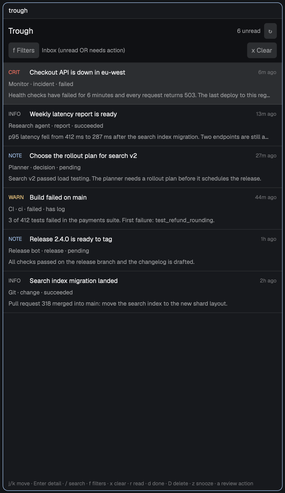

# Trough

Trough is a local activity feed for [Herdr](https://herdr.dev) desktop. Tools and agents publish short JSON stories ("the build failed", "a report is ready", "this needs your decision"); you read them as cards in a pane, file them as read or done, snooze them, and run their actions after reviewing exactly what each one will do.



- **Local.** Stories are files in a folder on your machine. There is no service, no account and no third-party package.
- **Immutable.** A published story never changes. Read, done and snooze are your own filing state, kept beside it.
- **Reviewed actions.** A story cannot name a command. Actions come from handlers you installed, and nothing runs until you confirm the exact effects. For a harmless local action such as showing a file in Finder, you can tick **Always allow** once and skip the sheet from then on.
- **Actions attach themselves.** A producer only describes its links ("this is a report", "this is a pull request"). The packs you installed decide what can be done with them: open it, show it in the file manager, add it to a reading list.
- **Usable without the pane.** The `trough` CLI does everything the pane does, so scripts and agents can publish and read stories on their own.

## Status

Version 0.2.0. The feed and the CLI need only Node.js (developed on Node.js 26; the tests also pass on Node.js 22). The pane needs Herdr desktop and has been used on macOS only.

| Platform | Open and reveal actions | State |
| --- | --- | --- |
| macOS | `open`, and `open -R` for Finder | Developed and used here, with the pane. |
| Linux | `xdg-open`; reveal asks the file manager over D-Bus (`gdbus`), else opens the containing folder | Tested from the CLI on a server without a desktop. Not yet used on a Linux desktop. Without `xdg-open` the actions are shown disabled. |
| Windows | PowerShell 7 (`pwsh`): the default app, `explorer /select,`, the default browser | Tested from the CLI up to the point of starting the app. Not yet used on a Windows desktop. Without `pwsh` the actions are shown disabled. |

On every platform you can put [your own handler](#your-own-handler) in front of the built-in one.

What the Linux and Windows tests covered, on 2026-11-13:

- **Linux** (Ubuntu 24.04, `sh` is dash, no desktop). The test suite passes with and without `xdg-open` installed. Without it, `trough actions`, `trough ls --json` and a review all report "xdg-open is not installed (it comes with xdg-utils)". With a stand-in `xdg-open` that records its arguments, open, open-url and reveal ran through `trough review` and `trough run` and passed paths and URLs unchanged, including spaces, quotes and `$(...)`. Reveal called a stand-in `org.freedesktop.FileManager1` service on the session bus with correct `file://` URIs for names with spaces, quotes, percent signs, non-ASCII letters and a newline, and fell back to `xdg-open` on the folder when no file manager answered. The real `xdg-open` 1.1.3 had nothing to open with on that machine, and the action failed with "xdg-open found no program to open it with". An opener that keeps running is left alone after 3 seconds. No real file manager, browser or desktop app was started.
- **Windows** (Windows 11 build 26200, PowerShell 7.6, over SSH). The test suite passes; tests that need a POSIX shell (the Firstmate pack, the stand-in `rl`, a shell script as your own handler) are skipped there. `windows.ps1` ran through `trough review` and `trough run` with `TROUGH_DRY_RUN=1`, which prints the program and arguments instead of starting them: names with spaces, quotes, `;&$()`, `%TEMP%` and non-ASCII letters arrived unchanged, and it refused anything that could run (`.bat`, `.exe`, `.ps1`, `.lnk`, `.js`, `.msi` and more), relative, UNC and forward-slash paths, a path with a double quote, a path that does not exist, and links that are not http or https. Your own handler was turned on, ran first, was stopped after an edit, and was refused when `BUILTIN\Users` could write the file or its folder. An SSH session has no desktop, so the last step (the app, Explorer or the browser appearing) was not run.

Paths written in a story's summary or prompt are clickable only in POSIX form (`/...` and `~/...`). On Windows, give the path as a link instead.

## Install

You need [Node.js](https://nodejs.org) 22 or later on your `PATH`, and Herdr desktop for the pane.

1. Get the files and copy the mod into your Herdr home. Keep its `bin/` and `core/` folders together.

   ```sh
   git clone https://github.com/pbleisch/herdr-trough.git
   mkdir -p ~/.config/herdr-app/mods
   cp -R herdr-trough/mods/trough ~/.config/herdr-app/mods/trough
   ```

2. Put the CLI on your `PATH`: `mkdir -p ~/.local/bin && ln -s ~/.config/herdr-app/mods/trough/bin/trough ~/.local/bin/trough` (or any other directory on your `PATH`).
3. Run `herdr-app check ~/.config/herdr-app/mods/trough`.
4. Show the pane. Either add `{"mod":"trough"}` as a block in a layout, or bind a key that opens it as an overlay. [`keys.json`](keys.json) suggests `cmd-shift-u`:

   ```json
   { "global": { "cmd-shift-u": "mod.open:trough" } }
   ```

   Merge that into `~/.config/herdr-app/keys.json`. `mod.json` uses `"place": "none"`, so installing the mod does not change an existing layout.

Stories live in `~/.local/state/trough` by default. Set `TROUGH_DIR=/absolute/path` (or pass `--dir`) for the CLI, and `{"mod":"trough","props":{"dir":"/absolute/path"}}` for a pane, to use another folder.

[`RECIPE.md`](RECIPE.md) describes the pane for anyone who wants to rebuild it rather than copy it.

## Publish stories

```sh
trough emit --source monitor --kind ci --title 'Build failed' \
  --summary 'Main branch verification failed.' --severity warning \
  --link Log=https://ci.example.com/runs/42 \
  --body-file failures.md --image /tmp/ci/failure-graph.png
```

`trough post --file story.json` accepts the full [v1 format](docs/story-v1.schema.json), and `trough validate --file story.json` checks a story without storing it. Required fields are `v`, `id`, `source`, `kind`, `title`, `summary`, `occurred_at` and `severity`. Unknown top-level fields are invalid. `source` and `provenance` are claims shown to the operator, not authority. `extensions` are inert. `group_key` groups cards within the same source and kind; each story keeps its own state.

Links carry the attach points for actions. Each link has an `id`, a `label` and either a `url` or an absolute `path`, and may say what it is:

```json
{"id": "report", "label": "Weekly report", "path": "/srv/reports/weekly.md", "role": "report", "media_type": "text/markdown"}
```

`role` is a short key. The conventional values are `report`, `document`, `artifact`, `log`, `screenshot`, `pr`, `issue` and `source`; other keys are allowed. `media_type` is a standard MIME type such as `text/markdown`, `application/pdf` or `image/png`. Both are optional. Stories stay small: link to a file, never embed it.

### Body and image

Two optional fields make a card richer. Older stories without them stay valid.

- **`body`**: markdown, up to 16384 characters (CommonMark with GFM tables and task lists). A card shows the title and the `summary`, clamped to two lines. Opening the card shows the whole summary, then the body. So write the body to continue the summary, not to repeat it. The summary stays required plain text: the CLI, search and notifications use it as the short version. Raw HTML in a body is shown as text, and image syntax (``) is shown as a link and never loaded. A web link opens in the browser, and an absolute path or `file://` link opens like a path in the summary. Other links are ignored.
- **`image`**: the `id` of one of the story's path links whose `media_type` is `image/png`, `image/jpeg`, `image/gif` or `image/webp`. The card shows a thumbnail, and the whole picture when it is opened. The link's label describes the picture, and clicking the picture opens the file.

```json
"image": "chart",
"links": [{"id": "chart", "label": "Error rate, last 30 minutes", "path": "/srv/monitor/eu-west-errors.png", "role": "screenshot", "media_type": "image/png"}]
```

Pictures are never fetched from the network. The pane can only draw files inside the Herdr home, so the first time a story is listed, the CLI copies its picture to `<Herdr home>/trough-media/`, named after the file's SHA-256. It copies only after these checks:

- the path is a regular file, not a symbolic link, a folder or a device;
- the file is at most 5 MiB;
- its first bytes show it is PNG, JPEG, GIF or WebP (never SVG);
- it is at most 4096 pixels on each side and 16 megapixels in total.

The copy is made once. A producer that changes the file afterwards does not change the card. A picture that fails a check leaves the card without it, and the reason is shown when the card is opened. `trough emit --image PATH` runs the same checks, adds the path link with role `screenshot` and the detected media type, and sets `image`. `--body TEXT` or `--body-file FILE` (`-` for stdin) sets the body.

Choose the lowest severity that fits:

| Severity | Use it for |
| --- | --- |
| `info` | Routine news that needs nothing, such as landed work or a finished report. |
| `notice` | Something that wants attention without a problem: a decision, an approval, a review. |
| `warning` | Work is blocked, a check failed, or a target is at risk. |
| `critical` | Something is down or data is at risk. |

### Publishing without the CLI

A producer can write files directly. Generate a 32-hex random ID or a ULID, serialize one story as UTF-8 JSON, and write it to `inbox/.<id>.<nonce>.tmp`. Flush and close it, then publish it as `inbox/<id>.json` **without replacement** (for example, hard-link the final name and unlink the temporary file). Never edit a published file. The importer ignores dotfiles, validates the file and its name, and stores it only if the ID is new or the bytes match the stored record. A different story with a used ID goes to `rejected/` and cannot replace the stored one. `trough rejections` lists invalid and conflicting submissions. The validator also checks timestamps, paths, link types, duplicate JSON keys, UTF-8 and a 64 KiB size cap.

## Read and file

The pane shows each story as a card that holds everything about it:

- **Header line.** The severity, then where the story comes from, then how long ago it happened.
- **Text.** The title, then the summary clamped to two lines, then a thumbnail if the story has a picture.
- **Link chips.** Click a chip to open the link. Its ▾ lists what can be done with the link: Open, Show in Finder, Add to reading list, and actions the story declares for it.
- **Bottom right.** The story's own action, if it declares one, next to a ⌄ caret that opens the card in place. An open card shows the whole summary, the markdown body, the full picture, every link's destination, the exact time and the story ID.
- **On hover or selection.** Done, Snooze, Read and ⋯ replace the time. ⋯ lists every action and the filing commands.
- **Decisions.** The options appear on the card. Picking one opens its review.
- **Sheets.** The review sheet and the delete confirmation open inside the card.

Stories with the same `group_key` (from the same source and kind) stack into one card showing the newest, with "N earlier" to show the rest.

| Key | Does |
| --- | --- |
| `j` / `k`, arrows | Move between cards |
| `g` / `G` | First / last |
| Enter | Open or close the card |
| `a` | Review the story's first available action, declared or offered |
| `.` | The card's ⋯ menu: `j`/`k` or arrows move, Enter runs, Escape closes |
| `o` | Open the card's first link |
| `1` to `9` | Answer a decision with that option, after a review |
| `/` | Search |
| `f` | Filter picker |
| `x` | Clear search and filters, back to Inbox |
| `r` | Read / unread |
| `d` | Done / undo |
| `D` | Delete, after a confirmation in the card |
| `z` | Snooze for one hour |
| Escape | Close the open sheet, menu or picker, or else close the card |

The pane opens in **Inbox**: stories that are unread or still need action, including read stories with unfinished actions. The filter picker also offers **Active unfinished** (neither done nor snoozed) and the state toggles `1` to `4` for unread, needs action, done and snoozed. State toggles combine with AND. Values picked within one field (source, kind, severity, subject) combine with OR, and fields, state and search combine with AND. Unread means no read time, needs action means the story declares actions and is not done, and snoozed means its snooze time is in the future. The header shows the active view and filters. Times are relative on the card and exact in its tooltip and in the open card. The pane reloads when the folder changes, including changes made by the CLI or another copy of the pane.

From the CLI:

```sh
trough ls --inbox                 # the pane's Inbox rule
trough ls --unread --source monitor --search build
trough ls --all --json            # every story, with state and action availability
trough show ID
trough read ID | unread ID | done ID | undo ID
trough snooze ID --until 2026-11-12T18:00:00Z
trough delete ID
```

`trough ls` shows Active unfinished by default. Done marks an unread story read; undo leaves the read state alone. Neither answers a decision nor changes anything at the source.

### Retention

The pane prunes read stories when it opens and hourly while open. `trough prune --dry-run` previews the IDs and `trough prune [--older-than 3d]` removes them on demand. The default age is 3 days, measured from the later of the read and done times; set `{"v":1,"retention":{"older_than":"7d"}}` in `$TROUGH_DIR/trough.json` to change it. Unread stories, open decisions, unfinished actions, active snoozes and anything with an effect still in flight stay. `trough delete ID` removes a story at once, including an open decision (it does not answer the decision), and refuses while an effect is still in flight. Both leave a small tombstone that blocks the same ID from reappearing for 365 days.

## Actions

Actions reach a story in two ways.

- **Offered by a pack.** Each installed pack looks at a story when it is shown and may attach actions to it, usually to its links. The built-in core pack offers **Open** on every link and **Show in Finder** (or the file manager) on every path link. The reading-list pack offers **Add to reading list** on report and document links. The producer does not need to know these actions exist, and a story published last week gains an action the day you install the pack that offers it.
- **Declared by the story.** A story may declare `actions` with an `id`, a `label`, a `handler` ID and typed `args`. This is for actions only the source can describe, such as answering a decision. A story cannot declare a command or an executable; the handler must already be installed on your machine.

Offers never change the stored story. They are worked out again whenever stories are listed, when an action is reviewed and once more when it runs, so an offer that is gone by then (the pack was removed, a fact changed) is refused. Only declared actions count toward "needs action".

Clicking an action opens a review sheet with the source claim, where the action came from (the story, or the pack that offered it) and the exact effects. A separate **Confirm action** click runs it once and writes a receipt. From the CLI, `trough review STORY ACTION` prints the sheet and a token, and `trough run TOKEN` runs it; `trough ls --json` lists each story's `offers` with their action IDs. A failed or uncertain action stays visible in `receipts/` and is never retried automatically.

### Always allow

Some actions are local and harmless enough that reviewing them every time is noise: showing a path in Finder, opening a link, adding a link to the reading list. Their review sheet has an **Always allow** checkbox. Tick it and confirm, and from then on a click on that kind of action runs at once, for every story, with no sheet. Each run still writes a receipt, marked `"approval": "always-allow"`.

- **What it covers.** One handler as offered by one pack, such as `core/open_path` (Show in Finder). Allowing that does not allow `core/open_url` or `core/open_file`.
- **What can never be always allowed.** Answering a decision, delivering a prompt to an agent, and any action a story declares itself. Only actions a pack offers qualify, and only when the pack's handler is marked as local and low-risk. The shipped ones are `open_url`, `open_path` and `open_file` from the core pack and `add_to_reading_list` from the reading-list pack.
- **Who can grant it.** Only you, by confirming a review. A story or a pack cannot.
- **When it asks again.** The approval is tied to what the handler runs. If that changes (you turn [your own handler](#your-own-handler) on or off or edit it, the mod is updated, a pack's file or options change, `rl` moves), the next click shows the sheet once, with the box already ticked. Confirm to keep allowing it, or untick the box to withdraw the approval.
- **See and revoke.** The **Always allowed** button in the pane header lists the approvals, each with a **Revoke** button. From the CLI:

```sh
trough allow                         # what is always allowed, and whether each still holds
trough allow revoke core/open_path   # or: trough allow revoke all
trough run TOKEN --always-allow      # confirm a review and always allow that kind of action
trough act STORY ACTION              # what a click does: run at once if always allowed, else print the sheet
```

Approvals live in `$TROUGH_DIR/allow.json`. Deleting the file clears them all.

An action that cannot run right now (its handler is not installed, a tool is missing, a decision has no answer route) is shown disabled with the reason beside it. `trough ls --json` reports the same per story, as `action_status` for declared actions and `available` on each offer.

`trough actions` lists every installed handler with its arguments and whether it can run, then each pack's rules for attaching actions:

```
$ trough actions
add_to_reading_list  pack reading-list  available  link:string note?:string
answer_decision      built-in           available  -
open_file            pack core          available  link:string
open_path            pack core          available  link:string
open_url             pack core          available  link:string
augment  pack core          URL link: Open (open_url)
augment  pack core          Path link: Open (open_file), and Show in file manager (open_path)
augment  pack reading-list  Link with role report or document, or a text, HTML or PDF media type: Add to reading list ...
```

Add `--json` for the full argument schemas, declared effects and facts. [docs/handlers.md](docs/handlers.md) covers operator command handlers, decision answers and writing a pack.

### Your own handler

Open and reveal run a small handler program. You can write your own, which Trough asks first, so a file or link opens the way you want on this computer. Whatever it leaves alone falls through to the built-in handler. It is off until you turn it on.

1. Write it at `~/.config/herdr-app/trough/handler` (`$HERDR_APP_HOME/trough/handler` if that is set; `trough\handler.ps1`, a PowerShell script, on Windows). It lives outside the mod's folder, so reinstalling the mod keeps it. Any language; it must be executable (`chmod 755`), owned by you and not writable by anyone else, and so must every folder above it.
2. Turn it on with `trough handler on`. Trough checks it and records its real path and SHA-256 beside it in `trust.json`. `trough handler` shows the state.
3. After you edit it, Trough stops running it: the pane shows a banner with **Use it** and **Turn off**, `trough packages check` reports it, and the built-in handler acts meanwhile. `trough handler on` approves the new version; `trough handler off` goes back to the built-in handler.

Trough runs it with separate arguments, never through a shell string. The item is always the last argument, right after `--`:

| Arguments | When |
| --- | --- |
| `open -- PATH` | Open a file or folder |
| `reveal -- PATH` | Show a path in the file manager; also used instead of `open` for anything that could run (an executable, a script, an app) |
| `open-url -- URL` | Open an http or https link |

Exit 0 when done, 10 for "not handled" (the built-in handler runs), and anything else for an error; the first line of stderr is shown. Trough waits 15 seconds, so start long-running programs in the background. The handler gets only the path or URL: titles, summaries and anything else in a story never reach it. The review sheet lists the exact programs and arguments, including your handler's path and the first characters of its SHA-256.

An example that opens markdown in VS Code and leaves everything else to the built-in handler:

```sh
#!/bin/sh
# ~/.config/herdr-app/trough/handler
verb=$1
for item; do :; done   # the item: the last argument
case $verb in
open)
	case $item in
	*.md | *.markdown) exec code "$item" ;;
	esac
	;;
esac
exit 10   # not handled: the built-in handler does it
```

The built-in handlers are [`mods/trough/handlers/macos.sh`](mods/trough/handlers/macos.sh), [`linux.sh`](mods/trough/handlers/linux.sh) and [`windows.ps1`](mods/trough/handlers/windows.ps1). They are replaced when the mod is reinstalled, so change behaviour with your own handler rather than by editing them.

## Packs

A pack is a JavaScript module that can add action handlers, attach actions to stories, and run a producer that publishes stories on an interval. Trough loads the built-in core pack and the packs you list, and you manage that list with `trough packages`:

```sh
trough packages                          # what is listed, what each provides, and its health
trough packages check                    # the same, and a non-zero exit if a pack is broken
trough packages add PATH [--options-file options.json]
trough packages remove NAME|PATH
```

```
$ trough packages
core  ok  (built in)
  handlers: open_file, open_path, open_url
  your handler: off
  augments: URL link: Open (open_url); Path link: Open (open_file), and Show in file manager (open_path)
  producer: none
reading-list  ok  /absolute/path/to/herdr-trough/packages/reading-list/index.js
  handlers: add_to_reading_list
  augments: Link with role report or document, or a text, HTML or PDF media type: Add to reading list ...
  producer: none
```

`add` takes a pack folder or module file, loads it once to make sure it works with the options given, and only then records its absolute path. Running `add` again with `--options-file` replaces that pack's options. The list lives in `$TROUGH_DIR/handlers.json`; these commands rewrite only its `packages` field and leave your other settings alone. You can still edit the file by hand. One pack that fails does not stop the others: its additions are dropped, and the problem is shown in the pane header and by `trough packages check`.

The core pack is on by default. `trough packages remove core` turns it off (it records `"core": false`), which removes the open and reveal actions and clickable paths; `trough packages add core` restores it.

A pack is trusted local code that runs with your permissions. Add only packs you have read.

Besides the core pack, this repository ships two packs, both optional:

| Pack | Adds | Needs |
| --- | --- | --- |
| [`packages/reading-list`](packages/reading-list/index.js) | **Add to reading list** on links with role `report` or `document`, or a text, HTML or PDF media type. | An `rl` command on `PATH` that accepts `rl add TARGET --from NAME --if-new [--note TEXT]`. Without it the action is shown disabled. Options: `{"rl":"/absolute/path/to/rl"}` names the command explicitly, and `{"roles":["report","document","log"]}` changes which link roles get the action. |
| [`packages/firstmate`](docs/firstmate.md) | Stories and actions for a Firstmate home. | A Firstmate home. Skip this pack if you do not use Firstmate; nothing else depends on it. |

Keep the checkout these packs are loaded from: the list stores their absolute paths. [docs/handlers.md](docs/handlers.md#packs) describes how to write a pack, with [a complete example](docs/example-pack/index.js).

## Data folder

`$TROUGH_DIR` holds `inbox/`, the immutable `store/`, per-story `state/`, `rejected/`, `reviews/`, `receipts/`, `answers/<source-id>/`, `tombstones/`, `media/` (which picture each story showed), and the operator files `handlers.json`, `trough.json` and `allow.json` (your [standing approvals](#always-allow)). Treat `handlers.json` and any pack it lists as code: whoever can write them can run commands as you. Your own open handler and its `trust.json` live in the Herdr home instead, under `trough/`. Copies of story pictures are kept in the Herdr home under `trough-media/`, one folder per data folder. Pruning and `trough delete` remove the copies no remaining story uses. The CLI finds the Herdr home from `--app-home DIR`, else `HERDR_APP_HOME`, else `~/.config/herdr-app`. The pane passes `--app-home` itself.

## Develop

```sh
npm test
herdr-app check mods/trough
```

Both use local files only. The tests need no Herdr, no network and no installed pack, and they start no app: on Linux a stand-in `xdg-open` goes first on `PATH`, and the Windows handler runs with `TROUGH_DRY_RUN=1`. Tests that need a POSIX shell are skipped on Windows.

## License

[MIT](LICENSE)
