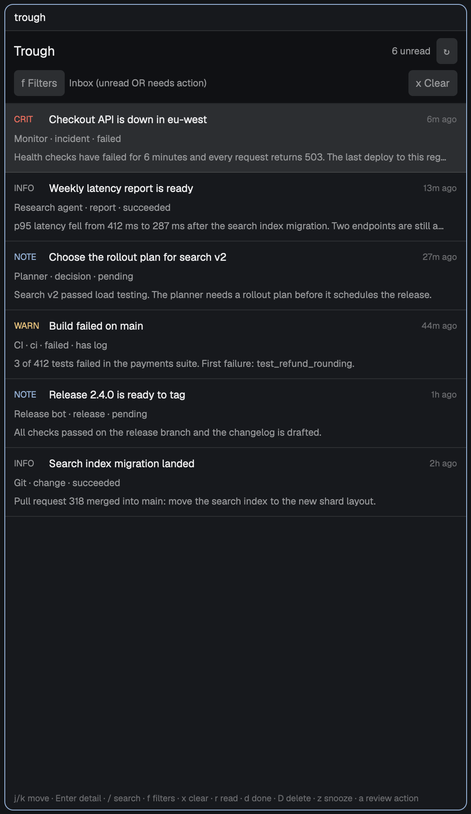

# Trough

A feed of short stories that tools and agents publish on this machine: a build failed, a report is ready, something needs a decision. The person scans a column of cards, opens one in place for its full text, picture and links, files it as read or done, snoozes it, or runs one of its actions after reading exactly what the action will do. Each card holds everything about its story; there is no separate detail view.

**What you see**

A single column, top to bottom. All colors are theme colors.

1. Header, on the chrome color with a bottom border, 10px side padding.
   - Title row: `Trough` in 15px semibold, then `N unread` in 11px muted, `N rejected` in the blocked color only when a submission was rejected, an `Always allowed` button (`Always allowed (N)` when there are standing approvals), and a `↻` reload button.
   - Filter row: an `f Filters` button, the active view and filters as one truncated 11px muted line (for example `Inbox (unread OR needs action) · severity: WARN · search: build`), and an `x Clear` button.
   - Filter picker, only while open: `Inbox` and `Active unfinished` buttons, a hint line `States (AND): 1–4 toggle`, four state buttons `1 unread`, `2 needs action`, `3 done`, `4 snoozed`, four field buttons `source`, `kind`, `severity`, `subject` (each with a count of picked values), and a 120px scrolling list of that field's values.
   - Always-allowed panel, only while open: a bordered box on the surface color with a 10px dim line (`These actions run without a review sheet, for every story. Each run still leaves a receipt.`), then one row per approval: the handler's declared effect in 11px, under it `pack/handler · allowed 2h ago` in 10px dim text (in the working color with ` · asks again: reason` when the approval no longer holds), and a `Revoke` button. With no approvals the box says how to add one.
   - Pack problem lines in the blocked color, one per problem: `Pack name: problem`. When the person's own open handler changed, a line `Your open handler is not used: reason` with `Use it` and `Turn off` buttons instead.
   - Producer line, only when a pack provides a producer: `Name: last 2m ago` per producer in 10px dim text, with ` · error: ...` after a failed run.
   - Search box, 27px tall, only while searching or when a search is set.
2. Error line in the blocked color, only when the last command failed.
3. Feed, filling the remaining height and scrolling, on the canvas color with 8px above and below and 6px between cards. Each card has 8px side margins, 12px left and 10px right padding, 5px top and 6px bottom padding, a 1px border (accent when selected), 8px corners and the surface color; a done or snoozed story is drawn at 60% opacity. Top to bottom:
   - A 3px severity bar down the left edge, in the severity color, except for info stories.
   - Header line, 20px: the severity label in 10px semibold (`INFO` muted, `NOTE` accent, `WARN` in the working color, `CRIT` in the blocked color); `Source label · kind · subject`, then ` · outcome`, ` · done`, ` · snoozed` and ` · badge` for each badge a pack added, in 11px muted text cut short with an ellipsis; and the relative time in 10px dim text (`just now`, `5m ago`, `3h ago`, `yesterday`, `4d ago`, then a short date) with the exact local time as its tooltip. While the card is hovered or selected, or its menu is open, four 20px icon buttons replace the time: Done (check), Snooze 1 hour (clock), Read or unread (envelope) and ⋯, each with a tooltip naming its key.
   - The title in 13px semibold on 17px lines, foreground when unread and muted when read, wrapping; a 6px accent dot before it while unread.
   - The summary in 12px muted text on 17px lines, clamped to two lines while the card is closed, ending in an ellipsis over the last line when it is cut. URLs and absolute paths in it are underlined in the accent color.
   - A 64×44 thumbnail on the right of the title and summary when the story has a picture: the picture scaled to fit, on the background color, 1px border, 5px corners.
   - While the card is open: the whole summary in the foreground color, the markdown body, the picture at the card's width (at most 220px tall, never enlarged), one `Label (role): destination` line per link, and `SEVERITY · source · exact local time · story ID` in 10px dim text.
   - `Image not shown: reason` in 10px dim text when the picture failed its checks.
   - A decision: an inset box on the raised color with the prompt in the accent color, a comment box when the story allows one and the card is selected, and one button per option (with `1`, `2`, ... in front while the card is selected; the option's answer text is the tooltip). Unavailable answers are dim labels with a line `Label is unavailable: reason`.
   - `N earlier · N need action` with a ▸/▾ chevron on the newest card of a group of two or more; open, the earlier stories follow as their own cards indented 24px.
   - `Last action: outcome · result` in 10.5px text (blocked color when it failed) after an action ran.
   - The action line, always last, 22px: the link chips (each a 20px pill on the raised color with the role's icon, the label cut short at 260px, and a ▾ menu when actions attach to the link), then the first declared action that is not a decision answer as an accent-outlined button with a bolt icon, then `+N in ⋯` when the story declares more, then the open/close caret (⌄/⌃) in the bottom-right corner. The chip for the link shown as the picture is left out.
   - A primary action that cannot run is dim, with a 10px line under the action line: `Label is unavailable: reason`.
   - Review sheet, inside the selected card, accent border: `Review action`, the source claim, where the action came from (`Action declared by the story` or `Action offered by pack core: Open`), the numbered exact effects, `Confirm action` and `Cancel`. For an action that may be always allowed, above the buttons: a 13px checkbox (accent fill and a check mark when ticked) labelled `Always allow: <the handler's declared effect>`, and a 10px dim line `Later clicks run at once, for every story (pack/handler). Revoke under Always allowed.` When an earlier approval no longer holds, a line in the working color says so and the box starts ticked.
   - Delete sheet, inside the selected card, blocked-color border: what will be removed, `Delete story` and `Cancel`.
   - Menus (the card's ⋯ and a chip's ▾): a popover on the popover color with a border and 7px corners, one row per item, the keyboard row highlighted. The card menu lists the declared actions not shown as the primary, every link's actions as `Action: link label`, offers that belong to no link, then `Mark read`/`Mark unread` (r), `Done`/`Undo done` (d), `Snooze 1 hour` (z) and `Delete…` (D). An unavailable item is dim with `Unavailable: reason` under it.
   - The title, summary, prompt and link lines wrap at the card's width, at any width; a long path or URL breaks mid-word. Chips wrap too.
   - An empty view shows `No stories in this view`.
4. Footer, with a top border: one 10px dim line of key hints.

As an overlay the pane is 640 by 560; docked in a layout it defaults to 420 wide.

**How it behaves**

- It opens in Inbox: stories that are unread, or that declare actions and are not done. Actions that packs offer do not keep a story in Inbox. `Active unfinished` shows stories that are neither done nor snoozed. Picking a state toggle leaves Inbox; state toggles combine with AND, values within one field with OR, and fields, state and search with AND.
- Keys while the feed has focus: `j`/`k` or arrows move between cards and keep the selected one scrolled into view, `g`/`G` jump to the first and last card, Enter opens and closes the selected card, `/` focuses search, `f` opens the filter picker, `1` to `4` toggle states while the picker is open, otherwise `1` to `9` answer the selected decision with that option (through its review), `x` clears everything back to Inbox, `r` toggles read, `d` toggles done, `D` asks to delete, `z` snoozes for one hour, `a` starts review of the first action that can run (declared first, then offered; an always-allowed offer runs at once), `.` opens the card's ⋯ menu (`j`/`k` or arrows move, Enter runs, Escape closes), `o` opens the first link. Escape closes the open sheet, picker or search, or else closes the selected card.
- Clicking a card selects it; the caret opens it in place. Selecting another card drops the review sheet, the delete sheet and an open menu of the last one.
- Stories that share a group show as one card, the newest; `N earlier` shows the others below it. Moving with the keys skips stories in a closed group.
- Clicking a link chip or a picture runs the core pack's `Open` offer for that link: at once when it is always allowed, otherwise through the review sheet. A chip's ▾ lists the link's other actions.
- An action never runs on the first click, unless the person always allowed that kind of action. The click asks the CLI for a review and shows the sheet; `Confirm action` runs it once and shows the outcome. Confirming with `Always allow` ticked also records a standing approval for that pack's handler; later clicks on such an action, for any story, run at once and show the outcome. Only actions a pack offers can have the checkbox, never a decision answer, a prompt delivery or an action the story declares. If what the handler runs changed since, the sheet comes back once with the box ticked; confirming with it unticked withdraws the approval. `Always allowed` in the header lists and revokes approvals. An action that needs a choice first lists the decision's options (and a comment box if the story allows one); picking an option opens the review.
- URLs in the summary, the prompt and the link lines of an open card are underlined in the accent color and open in the browser. Local paths are underlined too; clicking one opens the file or folder, or shows it in the file manager if it could run.
- A story body is drawn as markdown with `TextView`, after `markdown.js` turns raw HTML into text and image syntax into links, so a body can neither draw HTML nor load a picture. A clicked link opens in the browser when it is http or https, through `trough open` when it is an absolute path or a local `file://` URL, and is refused otherwise.
- The summary's clamp is measured: its natural height is reported with `on_size_change`, and the ellipsis appears only when it is taller than two lines. An element's background takes one color, not a gradient, and its line height is set as `17px`: a bare number there is a multiplier of the text size.
- Each card, and the header, is built on its own. When the kit refuses a value while building one (a value of the wrong type throws), that card shows its title and the error in its place and the rest of the pane still draws.
- The list reloads when the data folder changes and every 10 seconds; relative times refresh every 15 seconds.
- Read stories older than the retention age are pruned when the pane opens and hourly.
- Each pack producer runs when the pane opens and then on its own interval; one run at a time per producer.
- It does not show agent status. It shows only stories.

**Built from**

- One mod, `mods/trough`, with `mod.json` `{"place":"none","title":"Trough","size":420,"focusable":true,"overlay":{"width":640,"height":560}}`. Props: `dir`, the data folder (default `~/.local/state/trough`).
- `main.js` is a `View`. It uses `gpui-kit` (`View`, `div`, `svg`, `image`, `Background`), `gpui-base` (`v_flex`, `h_flex`, `InputState`, `Input`, `TextView`, `Popover`, `ScrollHandle`) and from `herdr`: `exec`, `watchFolder`, `theme`, `home`, `appHome`, `props`, `nextCommand`. `nextCommand` handles `focus`.
- The pane keeps no data of its own. Every read and write is `exec('node', [<appHome>/mods/trough/bin/trough, '--dir', dir, '--app-home', appHome(), ...])`: `ls --all --json`, `receipts`, `rejections`, `packages list --json`, `handler on|off`, `read`/`unread`/`done`/`undo`/`snooze`/`delete ID`, `review STORY ACTION [--option ID] [--comment TEXT]`, `act STORY ACTION` (for a pack offer: returns `{receipt}` if it ran on a standing approval, else `{review}`), `run TOKEN [--always-allow]`, `allow list --json`, `allow revoke KEY`, `open STORY PATH`, `producers`, `produce ID`, `prune`.
- `bin/trough` and `core/` are the store, the story validator, the action review and receipt logic, pack loading and augmentation, the core pack and pruning, in plain Node.js with no dependencies. `handlers/` holds the open and reveal scripts: `macos.sh`, `linux.sh`, `windows.ps1`, and `check-handler.ps1` for Windows. `feed.js` (views, filters, groups and the stacked cards), `links.js` (URL and path detection, body links), `markdown.js` (a story body made safe for `TextView`), `time.js`, `severity-label.js` and `producer-schedule.js` are small pure modules the pane imports.
- Programs it runs: `node`. Open and reveal run `sh` with `open` on macOS, `sh` with `xdg-open` and `gdbus` on Linux, and `pwsh` with `explorer.exe` on Windows; and, only after the person turns it on, their own handler at `<Herdr home>/trough/handler`. Packs the person lists in `handlers.json` may run more; the reading-list pack runs `rl`.
- Suggested key, in `keys.json`: `cmd-shift-u` to `mod.open:trough`.
- Icons: `icons/*.svg`, one-color 16px line drawings tinted with the text color (check, clock, mail, more, chevrons, bolt, and doc, link, log, pr and image for link roles). Story pictures come from `ls --json` as `media.src`, a path under the Herdr home's `trough-media/` that the CLI copied after checking the file.

**Watch out**

- The pane needs `node` on the app's `PATH`, and the CLI must sit at `mods/trough/bin/trough` under the app home with `core/` beside it. If the mod folder is renamed, change the `cli` path in `main.js`.
- The pane has been run on macOS only. The Linux and Windows handlers were tested from the CLI (see the README's Status section), not yet from a pane on those systems.
- Paths in a summary or prompt are recognised in POSIX form only (`/...`, `~/...`); a Windows path is clickable only as a link.
- `ls --json` returns `action_status` (declared actions), `offers` (pack actions, each with `available` and `reason`) and `badges` per story. Use them; do not guess from the handler name. An offer's ID has the form `pack.id` and is what `review` takes.
- The pane never decides that an action may skip the sheet. It calls `act` and shows whatever comes back, and it shows the checkbox only when the sheet carries `always_allow`.
- A person's own handler is never turned on by the mod itself, only by `Use it` after it changed or by `trough handler on`.
- Text that is a child of a row does not wrap by itself: the row grows past the pane and the text is cut off at the edge. Give each text item in a row `min_w(0)` (and `flex_1()` when it should fill the row) so it may shrink and wrap.
- `a` and the review flow act on the selected story. Drop a review sheet when the selection changes, or the sheet can confirm an action for the wrong story.
- While a text input has focus, keys belong to the input; only Escape returns focus to the list.
- The pane prunes on open. A check or a second copy pointed at the same data folder prunes too.
- A story whose declared actions are all unavailable still counts as "needs action" in Inbox until it is marked done.
- A group stacks only when it has two or more stories in the current view.
- `image()` loads only from the Herdr home, and the kit has no `object_fit`: draw a picture only from `media.src`, and size its box from `media.width` and `media.height`.
- There is no line clamp and no group hover in the kit. Clamp by height (lines × line height) and track the hovered card in the view's state.
- Stories are capped at 64 KiB, 16 links and 8 actions.

**Done when**

- `herdr-app check mods/trough` passes and `npm test` passes.
- `trough emit --source demo --kind note --title Hello --summary 'First story'` makes a card appear in an open pane without a reload click.
- `r` dims the title, `d` adds ` · done` and the story leaves Inbox, `x` returns to Inbox.
- A story with a URL link shows a chip for it without declaring any action; clicking the chip shows the review sheet with `Action offered by pack core: Open` and the URL inside the card, and only `Confirm action` opens the browser and adds `Last action: succeeded`.
- `trough emit ... --body '**Bold** <b>tag</b>' --image /path/to/shot.png` shows a thumbnail; the caret opens the card to the bold text, the literal `<b>tag</b>` and the full picture.
- A story whose declared action names a handler that is not installed shows that action dimmed with `handler <id> is not installed` and nothing happens on click.
- After `trough packages remove core` the chips' `Open` items disappear from every story; `trough packages add core` brings them back.
- `D` shows the delete sheet; `Delete story` removes the card and posting the same story again does not bring it back.
